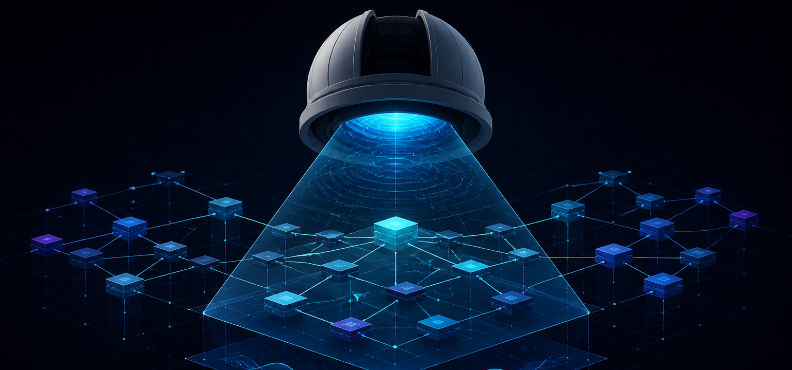
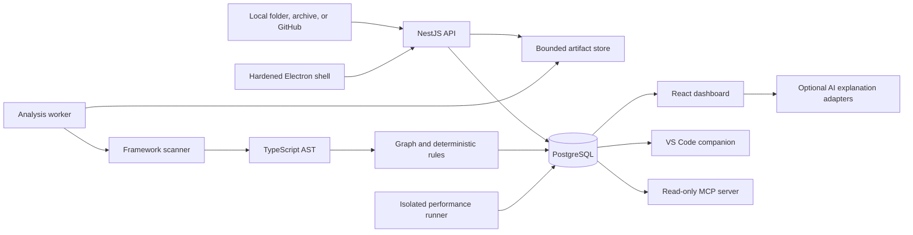

<p align="center">
  
</p>

# Engineering Observatory

> [!IMPORTANT]
> **Status: Work in progress.** The local desktop workflow and deterministic analysis core are usable today, but this is not a finished hosted product. Release signing, multi-tenant authorization, hosted isolation, and broader analyzer coverage remain active work.

Engineering Observatory is a local-first developer tool for understanding the health and architecture of a TypeScript repository before changing it.

I built it around a simple rule: **measure first, explain second**. Repository scanning, findings, scores, dependency paths, and performance results come from deterministic tools. AI is optional and can explain an existing finding, but it cannot invent evidence or change the result.

The project is also my practical answer to a common architecture question: how do you accept untrusted repositories, extract useful engineering signals, and still keep the system understandable and defensible?

## What it does

You can open a local folder, upload an archive, or connect a public/private GitHub repository. The Observatory then creates an immutable snapshot and builds an engineering profile covering:

- React, Angular, Next.js, TypeScript, Node.js, and NestJS;
- components, routes, hooks, services, state, API calls, tests, and module relationships;
- frontend, backend, database, dependency, and security review candidates;
- static change-impact paths backed by source locations;
- deterministic architecture, security, performance, and scalability scorecards;
- measured k6 or autocannon results for targets the user is authorized to test.

The dashboard includes an architecture graph, focused state/API/route views, issue filtering, source previews, scorecards, severity charts, and an analysis timeline.

## Why the AI boundary matters

I did not build an autonomous code-review agent. That would make the most important part of the product—the evidence—non-reproducible.

Instead, the workflow is:

1. scanners acquire a bounded repository snapshot;
2. deterministic analyzers produce findings and evidence;
3. scoring runs from a versioned policy;
4. optional OpenAI, Claude, Gemini, or Ollama adapters explain a selected result;
5. the original finding remains unchanged if the provider is unavailable or disabled.

There is also an optional read-only MCP server. It lets an existing MCP host retrieve completed profiles, findings, architecture summaries, and change-impact results. It cannot acquire source, start jobs, run AI, launch performance tests, access credentials, or mutate anything.

## Architecture



The API, analysis worker, and performance runner are separate processes. Repository code is treated as hostile data: the analysis path never installs its packages, imports it, builds it, or runs its scripts.

## Technology

| Area               | Choices                                                |
| ------------------ | ------------------------------------------------------ |
| Workspace          | Nx, TypeScript                                         |
| Desktop            | Electron with sandboxed, context-isolated renderer     |
| Frontend           | React, Vite, Tailwind CSS, React Query, Recharts       |
| Backend            | NestJS                                                 |
| Persistence        | PostgreSQL, Prisma, explicit SQL for leased jobs       |
| Analysis           | TypeScript compiler API, ts-morph, deterministic rules |
| Repository access  | Native folder adapter, bounded archives, Octokit       |
| Performance        | k6, autocannon, Lighthouse                             |
| Bundle inspection  | Rollup Visualizer                                      |
| AI explanations    | OpenAI, Claude, Gemini, Ollama                         |
| Developer adapters | VS Code extension, read-only MCP server                |

## Quick start: Electron app

This is the recommended way to run the project. You need Node.js 22.19+, npm, and Docker Desktop with Docker Compose.

```bash
git clone https://github.com/sujithgnth/engineering-observatory.git
cd engineering-observatory
npm ci
cp .env.example .env
docker compose up -d postgres
npm run desktop:dev
```

The first launch builds the workspace, applies database migrations, and opens the Electron app. The desktop process manages the API, analysis worker, performance runner, and UI; PostgreSQL continues to run in Docker.

Inside the app:

- **Local folder** opens the native directory picker and excludes generated folders, links, and oversized files.
- **GitHub URL** works without credentials for public repositories. Private repositories use a fine-grained read-only token encrypted through the operating system's credential backend.
- **Archive** accepts ZIP, TAR, TAR.GZ, and TGZ snapshots.

When you are finished, quit the Electron app and stop PostgreSQL:

```bash
docker compose down
```

To create a local application bundle:

```bash
npm run desktop:smoke
npm run desktop:pack
```

The package is intentionally not presented as a signed public release yet. macOS signing/notarization, final icons, trusted updates, and Windows/Linux release testing remain release work.

## Run it in the browser

```bash
npm ci
cp .env.example .env
docker compose up -d postgres
npm run db:migrate
npm run dev
```

Open [http://localhost:5173](http://localhost:5173). The browser, Electron app, and VS Code extension all use the same API and analysis engine.

## Optional MCP integration

With the Observatory running:

```bash
npm run mcp:build
npm run mcp:smoke
```

The server uses stdio and discovers the active Electron API over a short-lived loopback record. See [the MCP integration guide](docs/mcp-integration.md) for host configuration and the exact authority boundary.

## Performance and frontend quality

Static analysis does not pretend to know runtime scale. Performance results are stored only when k6 or autocannon actually runs against an explicitly authorized target.

The Observatory's own frontend can be checked with the installed ecosystem tools:

```bash
npm run quality:bundle
npm run quality:lighthouse
npm run quality
```

Rollup Visualizer explains what is shipped. Lighthouse measures a controlled browser run. k6 and autocannon measure an authorized HTTP target. These are different signals and the dashboard keeps them separate.

Connected repositories are not automatically installed or built to obtain bundle numbers. Doing that safely would require a disposable, rootless, network-restricted build service with strict resource and package-manager policies.

## Verification

```bash
npm run verify
npm run mcp:smoke
npm run desktop:smoke
npm audit
```

The repository contains focused React/Redux, Angular/NgRx, and Next.js/Zustand/GraphQL fixtures, archive-safety tests, analyzer tests, protocol-level MCP tests, and real PostgreSQL smoke coverage.

## Current limits

This is a production-shaped portfolio project, not a finished hosted SaaS. The important remaining work includes authentication, tenant authorization and RLS, quotas, hosted artifact storage, signed desktop updates, larger-graph layout, broader lockfile support, and stronger isolation for any future repository build runner.

Static analysis also has unavoidable blind spots around reflection, runtime dependency injection, custom wrappers, dynamic imports, and framework conventions it does not recognize. A zero-impact result means “no dependency was resolved,” not “this change is safe.”

I keep those limits visible because a developer tool is more useful when it says what it cannot prove.

## Documentation

- [Architecture and trade-offs](docs/frontend-intelligence-architecture.md)
- [Implementation status and honest limitations](docs/implementation-status.md)
- [Security and trust boundaries](docs/phase-1/security-and-trust-boundaries.md)
- [Scoring and evidence model](docs/phase-1/scoring-and-evidence.md)
- [Database model](docs/phase-1/data-model.md)
- [API design](docs/phase-1/api-design.md)
- [Local development runbook](docs/runbooks/local-development.md)

## License

**Proprietary — all rights reserved.** This repository is public for portfolio
review only. Copying, modification, redistribution, reuse, or incorporation into
another project is not permitted except for rights required by GitHub's Terms of
Service or with prior written permission. See [LICENSE](LICENSE).

The restriction applies prospectively. Versions already released under MIT
remain available under the MIT terms that accompanied those versions.
