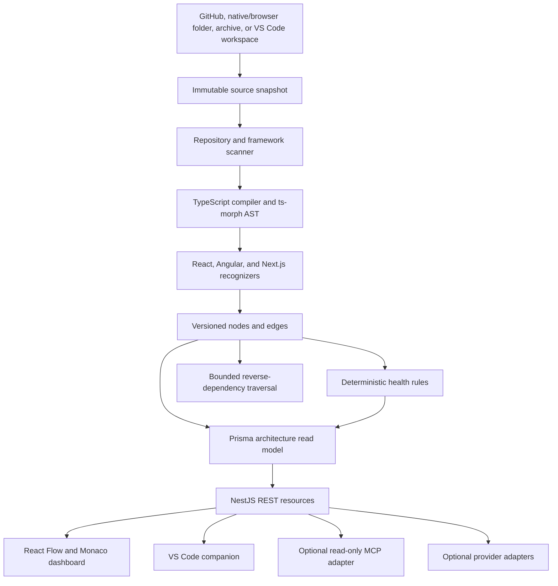

# Frontend Intelligence Engine architecture

## Product boundary

Frontend Intelligence Engine answers four practical questions:

1. What architectural elements exist?
2. How are they statically connected?
3. What evidence-backed risks are visible?
4. What resolved dependants might a change affect?

The deterministic engine owns every graph node, edge, issue, score, and impact count. AI is a replaceable explanation adapter over that canonical result. No model has tools, write access, or authority over evidence.

## Data flow

## Module responsibilities

| Module                  | Responsibility                                                   | Must not do                                 |
| ----------------------- | ---------------------------------------------------------------- | ------------------------------------------- |
| `scanners`              | Safe extraction, source inventory, framework/database profile    | Execute repository code                     |
| `frontend-intelligence` | AST symbols, graph edges, health rules, impact traversal         | Call AI or persistence                      |
| `analyzer-engine`       | Existing normalized frontend/backend/database/security findings  | Invent runtime measurements                 |
| `persistence`           | Durable jobs plus graph/read-model persistence                   | Contain analysis rules                      |
| `ai-adapter`            | Explain bounded canonical evidence                               | Create findings, scores, or graph edges     |
| `backend`               | Validation, resource APIs, source preview authorization boundary | Perform long-running scans in HTTP requests |
| `frontend`              | Explore/filter graph, evidence, scores, impact, source           | Recalculate canonical results               |
| `desktop`               | Native acquisition and lifecycle for canonical local services    | Expose Node.js/filesystem to the renderer   |
| `mcp-server`            | Expose bounded completed evidence over local stdio               | Scan source, call AI, run jobs, or mutate   |
| `vscode-extension`      | Acquire a trusted local workspace and consume the same API       | Become a second analysis implementation     |

## Important decisions

### TypeScript AST plus framework recognizers

**Why:** ts-morph exposes stable compiler nodes and source locations while keeping the graph builder testable. Small React/Angular/Next recognizers turn syntax into domain relationships.

**Alternatives:** regex-only scanning is cheaper but breaks on aliases and syntax variants; a language server offers richer resolution but adds process/runtime complexity; executing builds could resolve aliases but crosses the untrusted-code boundary.

**Trade-off:** dynamic imports, reflection, custom wrappers, external Angular templates, path aliases without resolvable source, and runtime DI may be incomplete. Every result is therefore static evidence, not runtime certainty.

**Production concerns:** parser CPU/memory isolation, repository/file caps, monorepo project-reference support, versioned graph migrations, false-positive telemetry, and incremental recomputation.

**Testing:** positive and negative framework fixtures, stable node IDs, exact source locations, graph invariants, adversarial parser/resource cases, and repeat-run determinism.

### PostgreSQL with explicit SQL and Prisma

**Why:** the existing leased-job workflow benefits from visible SQL transactions and row locking, while the highly relational architecture graph benefits from Prisma's generated mappings and batch APIs.

**Alternatives:** all Prisma reduces mapping code but obscures the deliberately demonstrated lease SQL; all hand-written SQL avoids two data layers but adds repetitive graph mapping; a graph database improves traversals but creates another operational system before measured need.

**Trade-off:** two persistence styles require a clear boundary. `ObservatoryStore` owns jobs and canonical analysis workflow; `ArchitectureGraphStore` owns only files/nodes/edges and graph metadata.

**Production concerns:** migration history, tenancy/RLS, graph-size limits, transaction duration, connection-pool budgets, retention, and indexed traversal/read models.

**Testing:** Prisma schema validation/generation, SQL migration on PostgreSQL, transactional graph replacement, reconstruction through the shared schema, and full API/worker smoke tests.

### Electron as a hardened local composition root

**Why:** native folder access removes browser upload friction, larger source limits are practical, and one launch can own the API, worker, performance runner, and dashboard lifecycle. The desktop remains a thin adapter around the canonical services and deterministic analyzer.

**Alternatives:** the browser is deployment-light but memory-bounded; VS Code is more contextual but requires an IDE; a CLI has the smallest runtime but less discoverability. Tauri reduces the bundled browser footprint but adds Rust and a second toolchain without changing the need for the existing Node analysis services.

**Trade-off:** Electron adds Chromium distribution size, platform packaging, signing/notarization, update policy, and a privileged main-process attack surface. PostgreSQL is still external, so this is a local desktop composition rather than a fully self-contained offline binary.

**Production concerns:** keep `contextIsolation`, sandboxing, Node integration disabled, a restrictive content security policy, denied permissions/navigation/windows, sender-validated narrow IPC, OS-encrypted credentials, bounded native acquisition, orderly child-process cleanup, signed artifacts, notarization, and verified updates. The renderer receives opaque selection IDs rather than arbitrary filesystem paths.

**Testing:** native snapshot boundary tests, IPC/API contract tests, development renderer smoke, packaged-application smoke, generated-directory/link exclusion, archive limits, migration/startup failure behavior, and release tests on every supported OS.

### Bounded change impact

**Why:** reverse traversal over resolved dependencies produces inspectable paths and is deterministic.

**Alternatives:** raw text search misses semantic links; transitive full-graph reachability can explode on enterprise graphs; AI impact analysis is non-reproducible.

**Trade-off:** traversal is capped at eight levels and can miss dynamic consumers. A zero-result means “none resolved,” never “safe.”

**Production concerns:** graph partitioning, path ranking, suppression of framework boilerplate, saved comparisons, and calibration against real refactors.

**Testing:** fan-in/fan-out fixtures, cycles, tested-by direction, depth bounds, file versus symbol selection, and missing-selection behavior.

## Stored model

- `analyses` remains the immutable workflow parent.
- `architecture_graphs` stores schema/analyzer versions, frameworks, issues, health, and coverage.
- `analysis_files` stores content identity and source metadata, not source blobs.
- `architecture_nodes` stores stable symbols and locations.
- `architecture_edges` stores typed relationships, confidence, and evidence locations.

Original source stays in the bounded artifact store. Monaco previews are read from the immutable snapshot only after the requested path is proven to belong to the persisted graph.

## Honest limitations

- Bundle size is not inferred from imports; it requires a real build artifact.
- Static import/render/API/DI resolution is incomplete for dynamic or custom abstractions.
- Named `gql` operations are recognized; full GraphQL schema/data-flow analysis is not implemented.
- External Angular HTML templates are not yet parsed into render edges.
- Health rules indicate review candidates and expose limitations; they do not prove production impact.
- The React Flow layout is deterministic lanes, not a large-graph clustering/layout service.
- Authentication, tenant authorization, RLS, quotas, hosted object storage, and audit identity remain production work.
