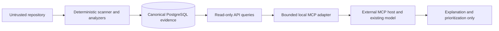

# Read-only MCP integration

## Decision

Engineering Observatory includes one optional local MCP server and no custom agents. The server exposes completed deterministic evidence to an MCP host over stdio. The host may ask its existing model to explain that evidence, but the model cannot use this server to create or change repositories, analyses, findings, scores, credentials, AI reviews, jobs, source files, or performance runs.

This preserves the authority boundary:



## Why

- It makes the product usable from MCP-compatible hosts without duplicating analysis logic.
- It demonstrates protocol integration, schema validation, dependency inversion, and trust-boundary design.
- Stdio gives a local host process ownership and avoids opening another unauthenticated network listener.
- The adapter remains optional; the Electron and browser products work when it is absent.

## Alternatives and trade-offs

- **Custom agent:** rejected. An autonomous tool loop adds non-deterministic authority and contradicts the product principle.
- **Remote Streamable HTTP MCP:** useful for a hosted product, but requires authentication, tenant authorization, rate limits, audit identity, TLS, and lifecycle operations that the local MVP does not have.
- **Direct database MCP:** rejected. It would couple the protocol to persistence, bypass API policy, and make future tenant enforcement harder.
- **Many third-party MCP servers:** rejected. GitHub acquisition already has a purpose-built Octokit adapter; unrelated servers increase supply-chain and permission surface without improving analysis evidence.

The trade-off is that the MCP server needs a running Observatory API. Electron writes `~/.engineering-observatory/desktop-runtime.json` with only its process ID, loopback API URL, schema version, and timestamp, then removes it during orderly shutdown. A crash can leave a stale file, but URL validation and request failure keep it from becoming remote access.

## Exposed tools

| Tool                        | Evidence returned                                         | Explicitly does not do                 |
| --------------------------- | --------------------------------------------------------- | -------------------------------------- |
| `list_repositories`         | Bounded repository IDs, names, source kind, creation time | Acquire GitHub or local source         |
| `list_analyses`             | Bounded immutable analysis records                        | Queue, cancel, retry, or delete jobs   |
| `get_analysis_summary`      | Profile, scorecards, severity counts, top findings        | Recalculate scores or call AI          |
| `list_findings`             | Bounded findings, redacted evidence, source locations     | Return raw repository files or secrets |
| `get_architecture_overview` | Counts, health, coverage, bounded architecture issues     | Return an unbounded raw graph          |
| `get_change_impact`         | Existing bounded deterministic reverse-dependency result  | Claim that zero impact means safe      |

Every tool declares read-only, non-destructive, idempotent, closed-world annotations. Inputs use Zod schemas, API responses are runtime validated, results are size-limited, and the API base URL must be credential-free loopback HTTP ending in `/api/v1`.

## Development setup

Start PostgreSQL and Electron, then build the MCP server:

```bash
docker compose up -d postgres
npm run desktop:dev
npm run mcp:build
npm run mcp:smoke
```

Register the built stdio server with a local MCP client. Configuration formats vary, but the portable command and arguments are:

```json
{
  "mcpServers": {
    "engineering-observatory": {
      "command": "node",
      "args": [
        "/absolute/path/to/engineering-observatory/dist/apps/mcp-server/main.js"
      ]
    }
  }
}
```

Restart or reload the MCP host after changing its configuration. The Electron app must be running when a tool actually queries evidence.

For the ordinary browser/API runtime, either keep the default API on port 3333 or configure the host process with:

```text
OBSERVATORY_API_URL=http://127.0.0.1:3333/api/v1
```

## Packaged macOS setup

The Electron package includes `services/mcp-server/main.js`. An MCP host can launch it through Electron's Node mode while the app is running:

```json
{
  "mcpServers": {
    "engineering-observatory": {
      "command": "/absolute/path/Engineering Observatory.app/Contents/MacOS/Engineering Observatory",
      "args": [
        "/absolute/path/Engineering Observatory.app/Contents/Resources/services/mcp-server/main.js"
      ],
      "env": {
        "ELECTRON_RUN_AS_NODE": "1"
      }
    }
  }
}
```

Client configuration formats differ. The command, arguments, and environment above are the portable concepts; use the current host documentation for its exact configuration file.

## Production concerns

- Do not add write tools merely because the protocol supports them. A new capability requires separate authorization and audit design.
- Treat repository names, paths, finding text, and graph metadata as untrusted model input.
- Keep raw source retrieval disabled unless an explicit per-request disclosure policy exists.
- Pin and audit the MCP SDK, cap response size and time, avoid stdout logging under stdio, and verify protocol behavior after SDK upgrades.
- A hosted MCP endpoint needs identity, workspace authorization, RLS, quotas, rate limits, audit events, TLS, and an OAuth/resource-server design.

## Testing strategy

- Protocol-level tests use the official in-memory transport and client to list and call tools.
- Unit tests prove output bounding, severity prioritization without mutation, and read-only annotations.
- `npm run mcp:smoke` launches the built stdio server through an actual client transport and verifies the exact tool surface.
- Desktop smoke proves the runtime discovery file is created only after the local API is ready and removed on shutdown.
- The full repository gate covers formatting, lint, types, tests, builds, packaging, dependency audit, and existing quality measurements.
