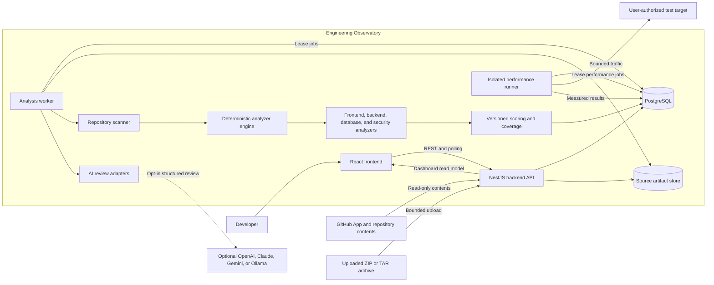
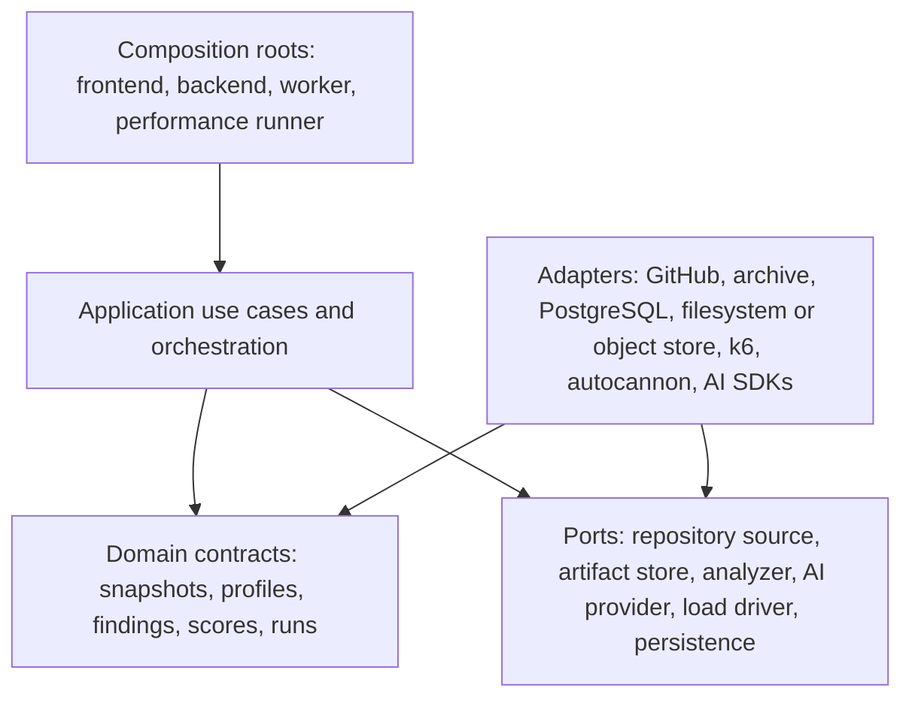
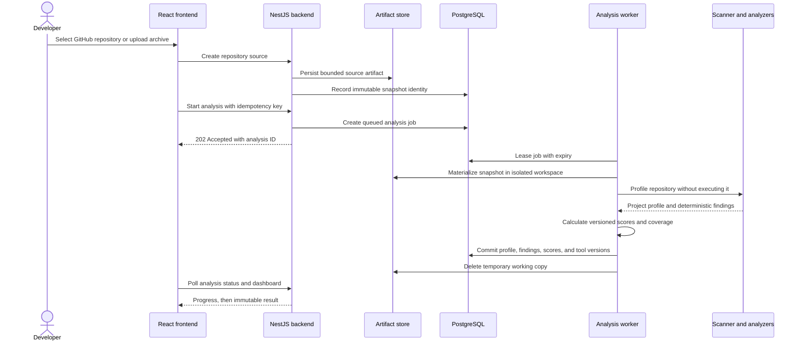
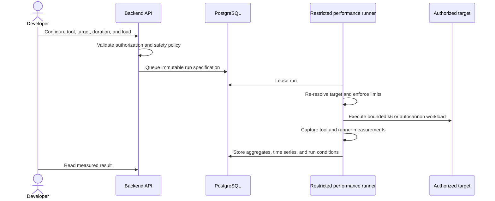

# Phase 1 architecture

## 1. Architectural outcome

Engineering Observatory starts as a modular monolith in an Nx monorepo with three core deployable processes:

1. **Frontend** — React dashboard and configuration UI.
2. **Backend** — NestJS HTTP API, authentication/authorization boundary, job coordination, and read models.
3. **Worker** — repository acquisition, safe extraction, profiling, deterministic analyzers, scoring, and optional AI enrichment.

Performance tools run behind a fourth, more restricted **performance-runner** process. It is separated from the normal analysis worker because load tools create materially different network, resource, and abuse risks.

An optional VS Code companion acquires a trusted local workspace and consumes the same backend graph; it does not contain a second analyzer. The implemented frontend graph, Prisma read model, impact engine, dashboard, and IDE boundary are detailed in [Frontend Intelligence Engine architecture](../frontend-intelligence-architecture.md).

PostgreSQL is the system of record and initially supplies the durable job queue. A source-artifact port uses a local filesystem adapter for development and can use S3-compatible object storage in a hosted deployment. This is one product with clear process boundaries, not a set of independently evolving microservices.

## 2. System context and main architecture diagram

The important direction is left-to-right: sources produce an immutable snapshot; deterministic tools produce evidence and scores; optional AI consumes a bounded copy of a finding. AI has no path back into source acquisition, evidence, severity, scoring, or job control.

## 3. Logical layers and dependency direction

Dependency rules:

- Domain contracts contain no NestJS, React, database, GitHub, AI SDK, k6, or autocannon dependency.
- Application services coordinate ports; they do not parse framework source or call vendor SDKs directly.
- Each analyzer implements one stable analyzer contract and declares which project-profile capabilities it requires.
- Adapters translate external formats into domain contracts. Vendor-specific errors do not leak into domain logic.
- Deployable apps are composition roots. They wire concrete adapters but contain little business logic.
- Nx module-boundary rules will enforce these directions in Phase 2; libraries will be created just in time, not all at once.

## 4. Core domain boundaries

| Boundary               | Owns                                                                     | Does not own                                       |
| ---------------------- | ------------------------------------------------------------------------ | -------------------------------------------------- |
| Repository acquisition | GitHub read-only checkout, archive validation, content digest, retention | Framework detection, analysis rules                |
| Repository scanner     | Workspace/package discovery, framework/database signals, project profile | Risk scoring, AI text                              |
| Analyzer engine        | Rule selection, analyzer execution, normalized finding collection        | Vendor SDK calls, persistence details              |
| Analyzers              | Deterministic rule logic and evidence                                    | Overall scoring, UI formatting                     |
| Scoring                | Versioned deductions, coverage, score explanation                        | Finding discovery, AI prioritization               |
| Performance            | Scenario validation, tool execution, normalized measured metrics         | Static findings, unsupported capacity prediction   |
| AI review              | Provider routing, redaction, structured explanation validation           | Evidence, severity, score, automated actions       |
| Reporting              | Dashboard read model, filtering, trends, finding lineage                 | Re-running analysis or mutating historical results |

### Core port semantics

The design uses conceptual contracts rather than framework-specific base classes:

- **Analyzer port** — receives a read-only safe repository view, versioned project profile, rule configuration, and execution budget; returns normalized findings, coverage, and bounded diagnostics. It has no persistence, AI, or arbitrary network authority.
- **Repository source port** — resolves a user-authorized source into an immutable snapshot identity and bounded artifact.
- **Artifact store port** — stores, reads, and deletes a source artifact by opaque tenant-scoped key and verified digest.
- **AI provider port** — receives one redacted review input and returns a schema-validated recommendation containing explanation, production impact, recommended solution, alternatives, and trade-offs.
- **Load driver port** — validates one tool-specific scenario, runs it within an execution budget, and returns normalized metrics plus tool-specific provenance.
- **Persistence ports** — expose aggregate-oriented operations and transactions; analyzers never receive a database repository.

`FrontendAnalyzer`, `BackendAnalyzer`, `DatabaseAnalyzer`, and `SecurityAnalyzer` implement the analyzer port. OpenAI, Claude, Gemini, and Ollama implement the AI provider port. k6 and autocannon implement the load-driver port while retaining distinct request schemas.

## 5. Repository-analysis flow

### Analysis invariants

- A scan always references one commit SHA or archive SHA-256 digest.
- Package lifecycle scripts and repository binaries are never executed by the static-analysis path.
- Findings are append-only for an analysis. Re-analysis creates a new analysis record.
- A completed analysis may contain warnings or skipped checks. Its coverage records exactly what ran.
- A failed job preserves safe diagnostic metadata but never stores source secrets or raw provider credentials.
- Job leases expire so a crashed worker can be recovered; writes are idempotent by analysis and stage.

## 6. AI explanation flow

AI review is a secondary use case, requested for a selected finding or an explicit bounded batch after deterministic analysis completes.

1. The backend loads the immutable finding, its safe evidence, score context, and project-profile summary.
2. A redaction policy removes secret values, credentials, unnecessary source, comments that are not needed as evidence, and repository metadata outside the approved context.
3. The AI adapter sends a structured request to the selected provider.
4. The response must validate against the recommendation schema: explanation, production impact, recommended solution, alternatives, and trade-offs.
5. The stored review records provider, model identifier, prompt-policy version, finding fingerprint, and generation timestamp.
6. The dashboard clearly labels the content as AI-generated. The original finding and score remain unchanged even if generation fails.

Repository text is treated as untrusted data, including when it contains prompt-like instructions. No model is given tools, repository write access, network actions, or job-control authority. Ollama provides the local/offline AI option; disabling every AI provider leaves the deterministic product fully functional.

## 7. Performance-simulation flow

The UI may offer 100, 1,000, and 10,000 as requested-load presets, but the model preserves tool semantics:

- k6 reports virtual users and iteration behavior;
- autocannon reports connections, pipelining, and request throughput;
- requested users/connections, achieved concurrency, duration, dropped work, errors, runner CPU/memory, and tool version are recorded separately;
- 10,000 virtual users are not promised on a single local runner. The runner can reject an unsafe configuration or report that requested load was not achieved;
- a bottleneck is confirmed only when evidence supports it. Without server telemetry, the result says “bottleneck candidate” and identifies the observed saturation signal.

## 8. Deployment topology

### Local portfolio mode

- frontend, backend, worker, performance runner, and PostgreSQL run locally;
- a filesystem adapter stores short-lived source artifacts;
- Ollama is optional;
- worker and runner concurrency default to one;
- private targets may be enabled only through explicit local configuration.

### Hosted mode

- frontend is served as static assets;
- backend, worker, and performance runner are separately scalable processes from the same monorepo;
- PostgreSQL remains the system of record;
- an S3-compatible artifact adapter replaces shared local storage;
- secrets are held in a secret manager, not application tables;
- default runner egress permits only validated public targets;
- each workspace is an authorization and data-isolation boundary.

The architecture permits these deployment differences through adapters; it does not require different domain logic.

## 9. Deliberate non-goals for the first release

- executing arbitrary uploaded repositories or running their tests;
- automatically fixing or committing code;
- custom AI agents, autonomous tool use, or AI-generated scoring;
- distributed load generation or a claim that a system supports 10,000 real users;
- live production database credentials or automatic `EXPLAIN ANALYZE` against production;
- language support beyond the named JavaScript/TypeScript frameworks and database patterns;
- microservice decomposition, Kubernetes, Kafka, or a separate search cluster without measured need.

## 10. Architectural quality strategy

| Quality          | Design response                                                   | Verification strategy                                               |
| ---------------- | ----------------------------------------------------------------- | ------------------------------------------------------------------- |
| Explainability   | Stable rule IDs, evidence locations, rule and score versions      | Golden fixtures and snapshot review                                 |
| Reliability      | Durable leased jobs, idempotent stages, immutable analyses        | Crash/retry integration tests with PostgreSQL                       |
| Security         | No source execution, bounded extraction, redaction, target policy | Malicious archive, SSRF, prompt-injection, and secret-leakage tests |
| Performance      | Async work, bounded concurrency, indexed read models              | Queue-load tests and API budgets before optimization                |
| Maintainability  | Ports/adapters, pure analyzers, enforced dependency direction     | Nx boundary checks and contract tests                               |
| Portability      | Local and hosted adapters for storage and AI                      | Adapter conformance suites                                          |
| Honest reporting | Coverage and unknown states; measured-load provenance             | Tests that skipped checks cannot create healthy scores              |

Detailed rationale, alternatives, production concerns, and test implications are recorded in [Architecture decisions](architecture-decisions.md).
