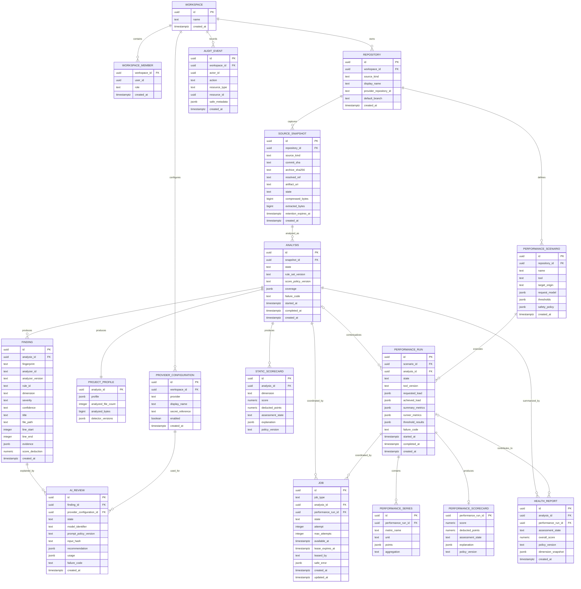
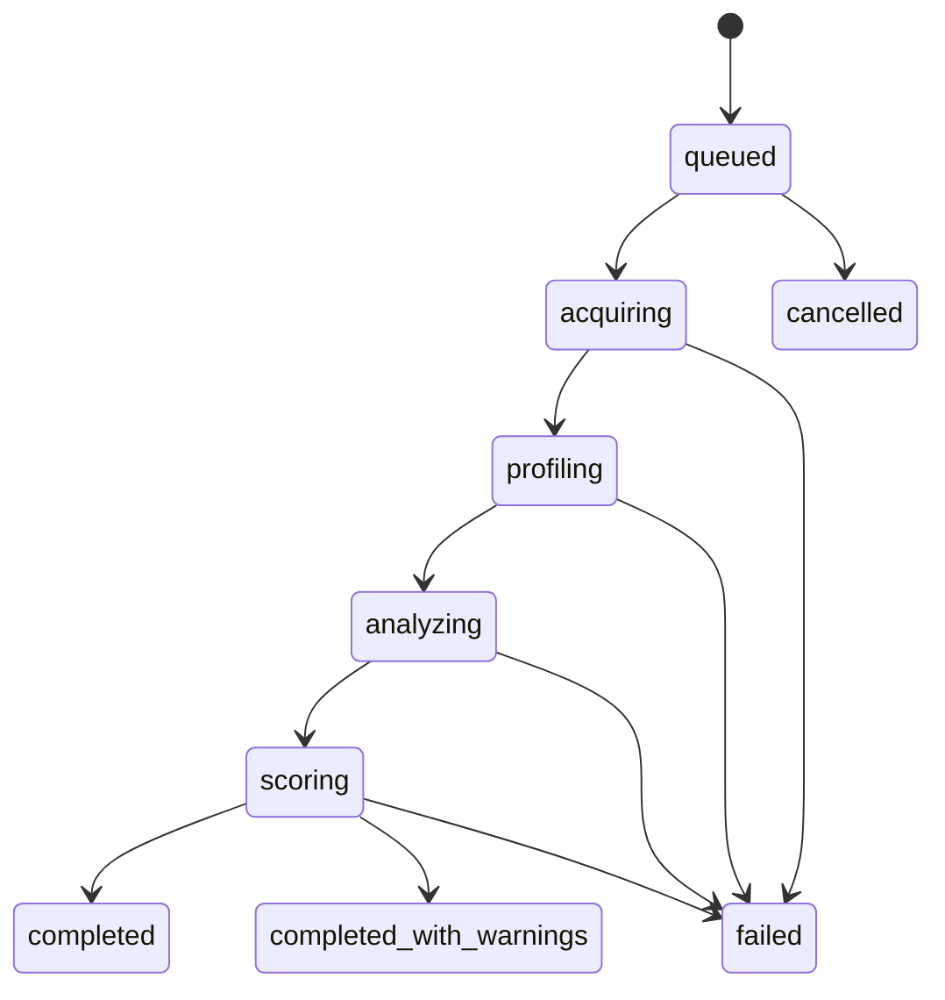
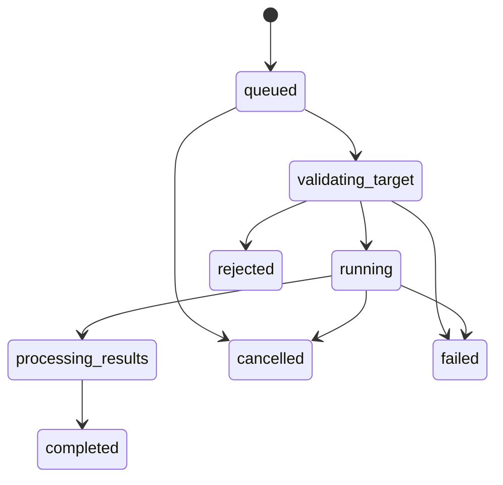

# Database model

## 1. Modeling principles

- PostgreSQL stores product state, normalized result metadata, jobs, and dashboard aggregates.
- Repository snapshots and analysis results are immutable. A rerun creates a new analysis.
- Large uploaded archives and working copies live behind the artifact-store port, not as database blobs.
- Stable, frequently filtered fields are columns; heterogeneous tool evidence and downsampled metrics use validated JSONB.
- Secret values, GitHub installation tokens, and AI API keys are never stored in these tables. Records hold secret-manager references or provider metadata only.
- Every tenant-owned row is reachable from a `workspace_id`, directly or through an immutable parent.
- Timestamps are UTC `timestamptz`; public identifiers are non-sequential UUIDs.

## 2. Entity relationship diagram

The diagram is logical rather than migration-ready. Exact enum/check syntax, foreign-key deletion behavior, and row-level security are Phase 2 migration decisions, but the invariants below are required.

## 3. Core entity decisions

### Workspace and membership

The first local release may seed one workspace and one user, but `workspace_id` exists from the start. Retrofitting tenancy after repository data, provider configurations, and audit history exist is risky. Hosted authorization checks must always scope by workspace; database row-level security is defense in depth, not the only authorization layer.

### Repository and source snapshot

`repository` is the logical project over time. `source_snapshot` is one immutable input:

- GitHub snapshot identity: provider repository ID plus resolved commit SHA;
- archive identity: SHA-256 of the exact uploaded bytes;
- exactly one of `commit_sha` or `archive_sha256` is required according to `source_kind`;
- user-supplied branch names are metadata, not immutable identities;
- rejected archives retain only safe validation metadata and the digest, not extracted content.

### Analysis and project profile

`analysis` is the aggregate root for one deterministic run. It records the rule-set and score-policy versions so an old result remains explainable after rules change. `coverage` records applicable, completed, skipped, unavailable, and failed checks.

`project_profile.profile` is JSONB because framework detectors evolve and repositories can contain multiple projects. It is validated at the application boundary and contains a version field. Frequently queried values can later be promoted to generated or normalized columns based on measured query needs.

The versioned project profile contains, at minimum:

- snapshot identity and scanner/detector versions;
- repository shape: single project or monorepo, workspace tool, package manager, lockfiles, analyzed/excluded file counts;
- projects with repository-relative root, kind, languages, framework names/versions when evidenced, build/test signals, and dependency summaries;
- frontend signals for React, Angular, TypeScript, routing, and rendering mode where detectable;
- backend signals for Node.js, NestJS, entry points, transport/API style, and supported validation/config conventions;
- database signals for MongoDB/PostgreSQL drivers, ORMs, schema/migration/index locations, without claiming a live connection;
- architecture signals such as dependency edges and project relationships;
- evidence location for every positive detection;
- coverage, exclusions, conflicts, and unknowns.

A repository can contain multiple frontend and backend projects. The profile never collapses a mixed monorepo into one misleading stack label.

### Finding and lineage

A finding contains a stable rule ID, deterministic severity, confidence, safe evidence, and source location. Its fingerprint is derived from repository identity, rule ID, normalized path, and a semantic anchor where available. It deliberately avoids the line number so harmless line movement does not break the issue timeline.

Findings are not edited in place. Across analyses, the dashboard derives:

- **new** — fingerprint first appears in the current analysis;
- **persistent** — fingerprint exists in both previous and current analyses;
- **resolved** — fingerprint existed previously and does not appear now, provided the responsible rule ran successfully in both analyses;
- **unknown** — comparison is invalid because the rule was skipped, failed, or changed incompatibly.

Evidence may contain a short redacted excerpt, observed values, and tool metadata. Secret scanners store the secret type, redacted prefix/suffix if safe, and a one-way fingerprint; never the full secret.

### Static scorecard, performance scorecard, and health report

Static analysis produces immutable scorecards only for dimensions supported by static evidence: architecture, security, and scalability. A completed performance run produces its own performance scorecard against the scenario's configured thresholds.

### Frontend architecture graph read model

The frontend-intelligence extension adds four relational tables under immutable `analyses`:

- `architecture_graphs`: schema/analyzer versions, frameworks, rule issues, frontend health, and coverage;
- `analysis_files`: repository-relative source identity, language, line/byte counts, SHA-256 content hash, and test flag;
- `architecture_nodes`: stable node ID/key, type, name, framework, location, and bounded metadata;
- `architecture_edges`: source/target node IDs, relationship type, confidence, and evidence location.

Nodes are the V1 persisted symbol model; a second `symbols` table would duplicate identity without a current query requirement. Source content remains in the immutable artifact and is exposed only through a bounded, graph-membership-validated preview endpoint.

An immutable `health_report` pins one analysis plus an optional compatible performance run and snapshots the four dimension states used for display. The initial report after analysis has no performance run and therefore a null overall score. Completing or selecting a later performance run creates a new report; it never edits the analysis or a previous report. `overall_score` remains nullable and is present only when all four dimensions are assessed under a compatible policy. See [Scoring and evidence](scoring-and-evidence.md).

### Provider configuration and AI review

Provider configuration stores non-secret routing metadata. In local mode, a secret reference can name an environment-variable key; in hosted mode it identifies a secret-manager entry. The database never stores the resolved API key.

An AI review is versioned enrichment linked to a finding. `input_hash` makes repeated identical requests detectable without retaining the full prompt. The validated recommendation JSON is kept separate from the deterministic finding.

### Performance scenario, run, and series

A scenario is a reusable requested configuration; a run is immutable measured evidence. Target credentials and raw query strings are not stored. Sensitive headers are resolved from a secret reference at runtime and removed from logs.

`summary_metrics` stores normalized aggregates such as requests per second, latency percentiles, error rate, timeouts, and dropped work. `achieved_load` is separate from `requested_load`. Downsampled time-series points are retained for charts; raw tool output is optional, size-bounded, and subject to short retention.

### Job

The job table supports both analysis and performance jobs but enforces that exactly one target foreign key is set. Workers lease queued rows with PostgreSQL row locking, record an expiry, and renew only while active. A retry creates another attempt on the same logical job; it does not create duplicate analysis findings or performance runs.

## 4. State machines

### Analysis

### Performance run

State transitions are compare-and-set operations. Terminal records are immutable except for explicitly modeled retention metadata.

## 5. Constraints and indexes

Required constraints:

- unique workspace membership on `(workspace_id, user_id)`;
- unique GitHub repository identity within a workspace;
- unique snapshot identity within a repository for commit SHA or archive digest;
- one project profile per analysis;
- unique finding occurrence on `(analysis_id, fingerprint)`;
- one static scorecard per `(analysis_id, dimension)` and only for architecture, security, or scalability;
- one performance scorecard per performance run;
- a health report's performance run, when present, belongs to the same repository context and is compatible with its analysis/policy;
- exactly one job target: analysis or performance run;
- no completed record without `completed_at` and no running record without `started_at`;
- numeric static, performance, and overall scores between 0 and 100 when non-null;
- line end is not before line start;
- JSONB payloads pass application-schema validation before persistence.

Initial indexes:

- analyses by `(snapshot_id, created_at desc)` and `(state, created_at)`;
- findings by `(analysis_id, severity)`, `(analysis_id, dimension)`, and `(fingerprint)`;
- jobs partial index on `(available_at, created_at)` for queued/retryable jobs;
- jobs partial index on `lease_expires_at` for leased jobs;
- performance runs by `(scenario_id, created_at desc)`;
- health reports by `(analysis_id, created_at desc)` and `(performance_run_id)` when non-null;
- audit events by `(workspace_id, created_at desc)`.

GIN indexes on large JSONB columns are not added pre-emptively. They should follow real query plans; otherwise they increase write and vacuum cost without evidence.

## 6. Transactions and idempotency

- Creating an analysis and its initial job is one transaction.
- A stage persists its outputs and advances the analysis state in one transaction.
- Completing static scoring stores the static scorecards, terminal analysis state, job completion, and initial partial health report atomically.
- Finding insertion is idempotent on `(analysis_id, fingerprint)`.
- Completing a performance run stores aggregates, series, thresholds, its performance scorecard, terminal state, job completion, and a new compatible health report atomically.
- API mutation requests accept an idempotency key scoped to workspace, route, and actor. The response identity is replayed for an exact duplicate and rejected for a conflicting payload.
- Job payloads contain identifiers, not duplicated source, findings, or credentials.

## 7. Retention and privacy

Suggested defaults, configurable per deployment:

| Data                                    | Default                                    | Rationale                                            |
| --------------------------------------- | ------------------------------------------ | ---------------------------------------------------- |
| Temporary extracted workspace           | Delete immediately after job               | Contains full untrusted source                       |
| Uploaded source artifact                | 24 hours after terminal analysis           | Supports retry without long-term source retention    |
| GitHub working copy                     | Delete immediately after job               | Can be reacquired by commit SHA if still available   |
| Deterministic profile, findings, scores | Retain until repository/workspace deletion | Core product history                                 |
| Redacted AI review                      | Retain until deletion                      | User-requested product output                        |
| Raw performance output                  | 7 days or disabled                         | Potentially large; normalized metrics are sufficient |
| Normalized performance aggregates       | Retain until deletion                      | Needed for measured trends                           |
| Audit events                            | Deployment policy                          | Security and administrative traceability             |

Deletion must remove artifact-store objects and database records, and record only a non-sensitive deletion audit event. Backups require a documented expiry; deletion is not honestly complete while unexpired backups remain.

## 8. Database testing strategy

- migration-up tests against a fresh PostgreSQL instance;
- migration compatibility test from every released schema version once releases exist;
- repository integration tests for tenant scoping and immutable-write constraints;
- job concurrency tests with multiple workers proving one lease per job;
- worker-crash tests proving lease expiry and idempotent retry;
- transaction rollback tests for partial findings, scores, and performance results;
- index/query-plan checks for dashboard queries using production-shaped cardinalities;
- retention tests that prove artifact deletion and safe database tombstoning;
- tests that null/unassessed scores cannot become 0 or 100 through persistence or serialization.
