# Implementation roadmap

## 1. Delivery strategy

Build one verifiable vertical slice at a time. A phase is complete only when its exit gate passes in a clean environment; generated files, a dashboard screenshot, or passing unit tests alone are not completion.

```mermaid
flowchart LR
    P1["Phase 1: architecture"] --> P2["Phase 2: Nx, React, NestJS"]
    P2 --> P3["Phase 3: safe repository scanner"]
    P3 --> P4["Phase 4: frontend analyzer"]
    P4 --> P5A["Phase 5A: backend analyzer"]
    P5A --> P5B["Phase 5B: database analyzer"]
    P5B --> P5C["Phase 5C: security analyzer"]
    P5C --> P6["Phase 6: engineering dashboard"]
    P6 --> P7["Phase 7: optional AI explanations"]
    P7 --> P8["Phase 8: measured performance"]
```

Phase 5B and 5C make explicit two required modules that were present in the product scope but absent from the original numbered development list. They do not change the requested phase order.

## 2. Cross-phase rules

Every implementation phase must:

- inspect and preserve the current green baseline before changing it;
- state the narrow deliverable and exclusions;
- add the production path and its failure behavior together;
- use deterministic fixtures before a polished UI;
- run formatting/lint, type checking, unit tests, relevant integration tests, and builds;
- record commands and outcomes without upgrading static verification into runtime/E2E claims;
- update architecture decisions only when implementation evidence changes them;
- avoid adding a dependency, service, or Nx library without a current boundary/use case;
- store source/tool/rule/policy versions with results;
- leave AI disabled and performance claims absent until their phases.

## 3. Phase 1 — architecture package

### Deliverables

- architecture and trust-boundary diagrams;
- database model and state machines;
- target Nx folder/dependency structure;
- REST API contract;
- evidence, scoring, and timeline policy;
- security boundaries;
- decision records with alternatives/trade-offs;
- this gated roadmap.

### Exit gate

- all required product modules have an owning phase;
- AI has no authority over deterministic output;
- performance claims require recorded runs;
- static source execution is explicitly prohibited;
- data, API, and state terminology is consistent;
- no application code or scaffold exists.

### Status

Documented. It should be reviewed before Phase 2 starts.

## 4. Phase 2 — Nx workspace, React app, and NestJS app

### Narrow objective

Establish a green, enforceable monorepo foundation and one thin HTTP-to-UI slice. Do not generate analyzer implementations.

### Deliverables

- Nx workspace with npm package management selected and documented;
- `apps/frontend`: React + TypeScript + Vite, Tailwind foundation, React Query provider, accessible application shell;
- `apps/backend`: NestJS bootstrap, configuration validation, request IDs, problem-details error mapping, liveness/readiness endpoints;
- initial `shared-types` and `api-contracts` only for health/system metadata;
- PostgreSQL development/test setup and the first migration for workspace plus a minimal system table if persistence is introduced here;
- Nx tags and module-boundary enforcement for existing projects;
- CI running install, lint/format check, typecheck, tests, build, and migration test;
- local developer README with exact prerequisites and commands.

### Decisions to verify now

- current compatible Nx, Vite, React, NestJS, TypeScript, Tailwind, test-runner, and Node versions must be checked at implementation time and pinned coherently;
- choose migration/query tooling based on type safety, transaction control, migration transparency, and NestJS fit—not popularity alone;
- confirm whether local identity is seeded or an authentication slice is required before any hosted demo.

### Testing strategy

- frontend render/accessibility smoke test;
- backend unit and HTTP integration tests for health/error behavior;
- API contract serialization test;
- real PostgreSQL readiness/migration test, not a mocked database claim;
- Nx dependency-rule failure fixture or configuration assertion;
- production builds for both apps.

### Exit gate

Fresh clone/setup documentation works; PostgreSQL migration succeeds; frontend calls the real backend health endpoint; lint/typecheck/tests/build pass; no analyzer, AI provider, or load-test mock is presented as complete.

### Interview evidence

Explain why the workspace begins with enforceable dependency direction and a verified vertical slice instead of a large generated folder tree.

## 5. Phase 3 — repository scanner

### Narrow objective

Safely transform a GitHub commit or archive into a versioned project profile without executing repository code.

### Delivery order

1. Define immutable snapshot, safe repository view, project profile, and coverage contracts.
2. Add artifact-store and repository-source ports.
3. Implement bounded archive streaming, digest, validation, extraction, and cleanup first.
4. Add the analysis worker and durable PostgreSQL job leasing.
5. Detect workspaces, package manager/lockfiles, projects, languages, React/Angular/Node/NestJS signals, and MongoDB/PostgreSQL signals with evidence.
6. Persist/retrieve a profile through the real API.
7. Add GitHub App acquisition by selected repository and resolved commit SHA.

Archive-first gives a locally demonstrable path while GitHub App configuration is still being built. It also forces the untrusted-input boundary to be implemented early.

### Explicit exclusions

- no dependency installation or repository build;
- no risk findings or score yet;
- no submodule/LFS traversal in V1;
- no AI;
- no performance run.

### Testing strategy

- good React, Angular, NestJS, mixed monorepo, MongoDB, PostgreSQL, and unknown fixtures;
- evidence tests for every detected capability;
- malicious archive suite: traversal, links, entry/byte explosion, corrupt headers, unsupported type;
- no-execution canary fixture;
- worker lease, crash, retry, cancellation, and cleanup integration tests with real PostgreSQL;
- GitHub permission/revocation/rate-limit adapter tests;
- end-to-end archive upload → queued job → profile API.

### Exit gate

The same snapshot and detector versions produce the same profile; rejected input leaves no extracted residue; worker failure is recoverable; profile coverage shows unsupported/skipped content; the archive and GitHub paths share the repository-source contract.

### Interview evidence

Explain immutable inputs, safe extraction, why source is not executed, and how a durable async workflow survives worker failure.

## 6. Phase 4 — frontend analyzer

### Narrow objective

Produce high-confidence, explainable React/Angular/TypeScript findings from semantic evidence.

### Initial rule candidates

- oversized component/function using reviewed size and complexity evidence;
- cyclomatic/cognitive complexity candidate with exact construct counts;
- dependency cycles and forbidden direction;
- route/module lazy-loading opportunity only where supported route evidence exists;
- React effect/subscription cleanup and unstable render-dependency patterns;
- Angular subscription/lifecycle cleanup and change-detection risk patterns;
- duplicated/derived state candidate, carefully confidence-labeled;
- dependency hygiene from manifests/lockfiles without installing packages.

“Unnecessary state,” “rendering problem,” and “lazy-loading opportunity” are not single regex rules. Each needs an evidence definition and negative fixtures; unsupported patterns remain unassessed.

### Deliverables

- frontend analyzer library and rule registry;
- normalized finding persistence/API;
- first calibrated architecture/scalability rule deductions and coverage;
- deterministic finding list available through API; a minimal developer view is acceptable, but not the Phase 6 dashboard.

### Testing strategy

- positive, negative, ambiguous, and framework-version fixtures per rule;
- exact path/line/semantic-anchor tests;
- generated/vendor exclusion tests;
- duplicate occurrence cap and monorepo project attribution;
- repeat-run determinism and parser timeout tests;
- false-positive review log for accepted rules.

### Exit gate

Every enabled rule has a documented risk, evidence, limitation, severity/confidence policy, positive fixture, negative fixture, and deterministic output. Coverage is truthful when parsing or framework support is absent.

### Interview evidence

Defend one React and one Angular rule from AST evidence through finding, cap, coverage, API, and false-positive trade-off.

## 7. Phase 5A — backend analyzer

### Narrow objective

Analyze supported Node.js/NestJS patterns without claiming runtime proof.

### Initial rule candidates

- missing input validation evidence at NestJS request boundaries;
- unbounded collection endpoint/missing pagination evidence;
- synchronous blocking filesystem/crypto/child-process calls in request paths;
- swallowed errors, overly broad catch behavior, and unsafe error disclosure;
- large static response construction or unbounded serialization candidate;
- authentication/authorization decorator/guard gaps only for explicitly modeled conventions;
- unsafe CORS/configuration patterns where statically evident.

### Testing strategy

- controller/service/DTO positive and negative fixtures;
- global validation/guard configuration fixtures to prevent route-level false positives;
- path-sensitive call evidence for blocking operations;
- pagination patterns across supported ORMs;
- custom abstraction fixtures labeled unsupported rather than safe.

### Exit gate

Backend findings are evidence-backed and confidence-labeled; global framework configuration is incorporated where supported; no finding claims an endpoint is exploitable or a response is large without corresponding evidence.

### Interview evidence

Explain request lifecycle, validation boundaries, event-loop blocking, unbounded I/O, and how static limitations affect severity/confidence.

## 8. Phase 5B — database analyzer

### Narrow objective

Detect MongoDB/PostgreSQL schema/query/index risk candidates in supported driver/ORM patterns.

### Initial rule candidates

- unbounded find/select and offset/page-size risk;
- N+1 query patterns where a loop-to-query call path is statically evident;
- selected/sorted/filter fields without a matching declared index candidate;
- non-selective or redundant index/schema smells where declarations are visible;
- MongoDB schema/index and PostgreSQL migration/index drift between recognized definitions;
- transaction boundary misuse patterns where supported.

### Production boundary

Use “candidate” language for index/query findings. Do not connect to a database or run `EXPLAIN ANALYZE` in this phase. A later read-only test-environment query-plan adapter requires a separate architecture/security decision.

### Testing strategy

- Prisma/TypeORM/Mongoose or other specifically selected adapters only after support is declared;
- composite-index order, projection, pagination, dynamic-query, and false-positive fixtures;
- no-index-visible versus index-in-separate-migration fixtures;
- assertions on cautious wording and confidence.

### Exit gate

Supported ORM/driver scope is explicit; candidates link query evidence to visible schema/index evidence; unknown dynamic behavior does not become a confirmed bottleneck.

### Interview evidence

Explain why source can identify risk candidates but data distribution, workload, and query plans determine real index value.

## 9. Phase 5C — security analyzer

### Narrow objective

Add passive secret, unsafe-pattern, dependency-advisory, and insecure-configuration findings without active exploitation.

### Deliverables

- redacted secret detection with one-way fingerprints;
- supported framework security rules with evidence and limitations;
- lockfile advisory adapter recording source/database/tool timestamp and version;
- stale/offline/unavailable advisory coverage states;
- explicit passive-analysis policy in product UI/docs.

### Testing strategy

- canary secrets proved absent from stored evidence, API responses beyond redacted form, logs, traces, and errors;
- entropy/pattern false-positive fixtures;
- advisory fixtures pinned to recorded data; offline/stale behavior;
- unsafe config positive/negative fixtures;
- no network traffic to repository-discovered URLs.

### Exit gate

No full secret survives the pipeline; dependency results are provenance-stamped; skipped/unavailable advisory data is not green; no active scan occurs.

### Interview evidence

Explain secret handling, advisory freshness, passive-versus-active security boundaries, and the difference between a vulnerability pattern and exploitability.

## 10. Phase 6 — engineering health dashboard

### Narrow objective

Turn deterministic evidence into an accessible, decision-oriented React experience.

### Views

- repository/snapshot selector with commit or archive digest provenance;
- analysis state and coverage;
- category scorecards for architecture, security, performance, and scalability;
- overall score only when all dimensions are assessed;
- severity distribution and finding filters;
- findings table/detail with evidence, limitations, location, and deterministic remediation;
- issue timeline using compatible finding fingerprints;
- recommendation queue separated into deterministic and AI-generated content;
- performance panel showing “Not measured” until a valid run exists.

### React architecture

- server state through React Query; URL owns filter/selection state worth sharing;
- presentational chart components receive view models, not raw API payloads;
- virtualization only after measured need;
- route-level code splitting at meaningful feature boundaries;
- Recharts for data charts with accessible table/text alternatives;
- Tailwind tokens/components kept small and consistent rather than page-specific style sprawl.

### Testing strategy

- component tests for loading, empty, partial, failure, and terminal states;
- MSW/network-boundary tests for API contracts;
- keyboard, focus, contrast, reduced-motion, and screen-reader semantics;
- responsive checks at phone/tablet/desktop widths;
- chart equivalence via text/table summaries, not image-only assertions;
- Playwright end-to-end archive scan → profile/findings/dashboard;
- render-count and bundle-budget checks only with recorded baselines.

### Exit gate

The dashboard cannot hide skipped checks, render fixture metrics as real, conflate AI with deterministic results, or claim performance without a run. Core flows pass keyboard/accessibility and real-backend E2E.

### Interview evidence

Explain server-state ownership, URL state, chart accessibility, partial failure, bundle boundaries, and how UI wording protects evidence integrity.

## 11. Phase 7 — AI explanation layer

### Narrow objective

Add optional provider-backed explanation for immutable findings while the complete deterministic product continues to work with no AI configuration.

### Delivery order

1. Finalize provider-neutral review input/output and redaction policy.
2. Implement Ollama first for a local, no-API-key path.
3. Add provider conformance tests and mocked adapters.
4. Verify current official SDK/API, model, structured-output, pricing, retention, and rate-limit behavior before implementing OpenAI, Claude, and Gemini adapters.
5. Add opt-in UI, context disclosure, retry/regeneration, provenance, and deletion.

### Testing strategy

- AI-disabled end-to-end regression;
- adapter schema conformance, timeouts, rate limits, refusal, malformed output, and cancellation;
- prompt-injection repository fixture;
- canary leakage capture;
- safe Markdown/text rendering and XSS payloads;
- concurrency/cost/token limits;
- tests proving review cannot modify canonical finding/score records.

### Exit gate

At least Ollama plus one external adapter passes the same conformance suite; external behavior is verified against current official documentation; provider failure is isolated; user can see provenance and remove reviews; no AI key or unredacted secret is stored/logged.

### Interview evidence

Explain dependency inversion across providers, data minimization, structured-output validation, failure isolation, and why this is an adapter—not an agent.

## 12. Phase 8 — performance simulation

### Narrow objective

Produce bounded, reproducible k6/autocannon measurements against a controlled or authorized target.

### Delivery order

1. Build a local controlled target fixture with known endpoints and safe limits.
2. Define separate k6 and autocannon request models; do not translate both into an ambiguous “users” value.
3. Implement runner process isolation, fixed binary invocation, timeouts, quotas, cancellation, and cleanup.
4. Implement target authorization policy, DNS/IP/redirect validation, and credential/header controls.
5. Normalize recorded outputs into immutable performance runs.
6. Display requested versus achieved load, RPS, latency, p95/p99, errors, dropped work, runner saturation, thresholds, and limitations.
7. Enable 100 preset after controlled verification; enable 1,000 or 10,000 only when the runner proves it can generate the load safely. Otherwise keep them visible as unavailable/capacity-rejected options.

### Testing strategy

- recorded parser fixtures for supported tool versions;
- real tool smoke run against the controlled fixture target;
- target-policy suite for private/metadata/encoded/redirect/DNS-rebinding destinations;
- argument/header injection and secret-log capture;
- timeout, cancellation, process-group cleanup, crash, and retry behavior;
- requested-versus-achieved mismatch;
- threshold boundary calculations;
- runner CPU/memory saturation reporting;
- repeat runs documenting environmental variance rather than hiding it.

### Exit gate

A clean environment can reproduce a controlled run; every result records scenario/tool/environment/achieved load; unsafe targets/configurations are rejected; cancellation works; no claim exceeds measured evidence; the API remains responsive during a run.

### Interview evidence

Explain load-model semantics, p95 versus averages, coordinated omission/tool limitations, client-versus-server bottleneck evidence, safe target policy, and why 10,000 configured users are not 10,000 proven real users.

## 13. Final release gate

The portfolio release is ready only when:

- a fresh archive and a selected GitHub commit complete the real worker/DB flow;
- representative React/Angular/NestJS/MongoDB/PostgreSQL fixtures produce reviewed findings;
- secret and malicious-input suites pass;
- dashboard EN content, light/dark behavior if supported, responsive layout, keyboard/accessibility, console, and interaction QA pass;
- AI-disabled flow is complete and AI-enabled reviews remain separate;
- at least one controlled k6 and autocannon run is recorded end to end;
- lint/typecheck/unit/integration/E2E/build/migration checks pass from a documented clean setup;
- architecture, scoring policy, threat model, API contract, runbooks, and known limitations match the implementation;
- the demo script separates what was statically verified, integration-tested, runtime-measured, and not yet proven.

## 14. Senior interview narrative

The strongest narrative is not “I built a scanner with AI.” It is:

> I designed an evidence pipeline for untrusted repositories. Immutable snapshots feed versioned deterministic analyzers; coverage prevents skipped checks from becoming green scores; long-running jobs recover through leases and idempotency; AI is a replaceable explanation adapter; and performance claims include the exact tool, scenario, achieved load, environment, and limitations.

For each phase, retain one concrete design trade-off, one failure discovered by testing, one production boundary, and one measurement or reproducible test. That is stronger Senior/Architect evidence than a large feature list.
