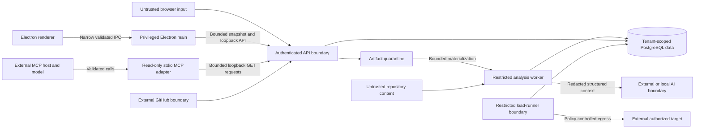

# Security and trust boundaries

## 1. Security position

Engineering Observatory accepts hostile inputs by design: repositories, archives, configuration files, dependency metadata, URLs, tool output, and AI output. Static analysis is passive. It parses source but does not install dependencies, run lifecycle scripts, import application modules, execute repository binaries, start the uploaded application, or perform penetration testing.

Performance testing is a separate, explicit action against a target the user affirms they are authorized to test. It is never triggered automatically by repository analysis.

## 2. Assets

- private repository source and metadata;
- GitHub App installation authority;
- optional AI provider keys and performance-target credentials;
- findings that may reveal vulnerable locations;
- redacted secret-detection evidence;
- performance targets and results;
- workspace membership and authorization data;
- worker/runner compute and network access;
- scoring integrity and analysis provenance.

## 3. Trust boundaries

The API, analysis worker, and performance runner have different permissions:

- API can authenticate users, coordinate jobs, and access product data but does not execute analysis tools or load tests.
- Analysis worker can read a leased source artifact and write result data. It has no AI provider access unless executing an explicit AI-review job, and it has no general target-testing authority.
- Performance runner can read one sanitized run specification and resolved credential reference. It cannot read repository artifacts or AI keys.
- Electron renderer is sandboxed, context-isolated, has no Node integration, and can invoke only an allow-listed preload API. The main process validates the sender, owns native filesystem dialogs and encrypted local credentials, blocks navigation/windows/permissions, and passes bounded snapshots to the API.
- MCP is a separately launched, read-only stdio adapter. It accepts validated IDs and limits, connects only to a credential-free loopback API, caps response bytes and time, and exposes no source, credentials, mutation, job, AI-call, or performance-run capability.

## 4. Threats, controls, and verification

| Threat                                   | Primary controls                                                                                                                  | Verification                                                                               |
| ---------------------------------------- | --------------------------------------------------------------------------------------------------------------------------------- | ------------------------------------------------------------------------------------------ |
| ZIP slip/path traversal                  | Normalize paths; reject absolute paths, `..`, drive prefixes, NULs, and escaping links; extract into a fresh job directory        | Malicious ZIP/TAR fixture and property tests                                               |
| Archive bomb/resource exhaustion         | Compressed, extracted-byte, entry-count, nesting, file-size, and time limits; stream with backpressure; abort cleanup             | Boundary and high-compression fixtures; disk/quota tests                                   |
| Symlink/hardlink escape                  | Reject links by default; never follow links outside root                                                                          | Link fixture tests on supported platforms                                                  |
| Repository code execution                | No install, build, import, test, or lifecycle commands; parsers operate on bytes/AST only                                         | Canary fixture whose scripts would create a file or network request; assert neither occurs |
| Parser/tool denial of service            | Per-file and total byte limits, timeouts, bounded concurrency, worker memory/CPU limits                                           | Oversized/minified/deep-AST fixtures and forced timeout tests                              |
| Secret leakage in findings               | Redact matched value; store type and one-way fingerprint; sanitize logs/errors/telemetry                                          | Seeded canary secrets asserted absent from DB/API/log captures                             |
| Cross-tenant access                      | Workspace-scoped repositories, authorization policies, opaque IDs, optional row-level security                                    | Full cross-workspace authorization matrix                                                  |
| GitHub token theft                       | GitHub App, least privilege, short-lived installation tokens, secret manager, no token logging                                    | Permission review, log-capture tests, token revocation test                                |
| Desktop privilege escalation             | Sandboxed/context-isolated renderer, no Node integration, strict CSP, denied permissions/windows/navigation, sender-checked IPC   | Preload contract tests, renderer smoke, dependency patching, packaged-app security review  |
| Desktop filesystem overreach             | Native picker in main, opaque selection IDs, no path IPC, no symlink following, allow-listed files and hard size/count caps       | Native acquisition boundary, link, generated-folder, and oversized-input tests             |
| MCP confused deputy or context expansion | Read-only allow-list, loopback-only API, bounded outputs, no source/credentials/actions, untrusted-evidence instructions          | Official protocol client tests, exact tool-list smoke, schema/size/URL policy tests        |
| GitHub webhook forgery/replay            | Signature verification over raw body, delivery-ID deduplication, size/event allow-list                                            | Invalid signature and duplicate-delivery tests                                             |
| Dependency advisory poisoning/staleness  | Pinned scanner, TLS/source validation, record advisory source/version/time, show stale/unavailable state                          | Recorded advisory fixtures and offline/stale tests                                         |
| Prompt injection from source             | Treat source/comments as quoted data; minimal redacted context; strict response schema; no model tools/actions                    | Adversarial source fixture instructing model to reveal keys/change score                   |
| AI data exfiltration                     | Opt-in provider use, context preview/limit, redaction, provider policy disclosure, local Ollama option                            | Leakage tests with canary credentials and provider-mock capture                            |
| AI output injection                      | Render as text/Markdown through safe renderer; no raw HTML; no code execution; schema validation                                  | XSS payload and malformed-response tests                                                   |
| SSRF through performance target          | Scheme/port allow-list, DNS/IP policy, redirect revalidation, block metadata/private ranges by default, resolve at execution      | Loopback, metadata, encoded-IP, redirect, and DNS-rebinding tests                          |
| Unauthorized load generation             | Explicit affirmation, target policy, workspace quotas, maximum rate/VUs/duration, concurrency caps, audit event, kill switch      | Policy tests and forced cancellation under load                                            |
| Runner compromise/resource exhaustion    | Separate process/container, non-root, read-only filesystem where possible, CPU/memory/network limits, command argument allow-list | Resource-limit integration tests and argument-injection fixtures                           |
| Command injection                        | Never construct shell strings from input; fixed binary plus structured validated arguments/config files                           | Metacharacter and malicious-header tests                                                   |
| Credential exposure to target/logs       | Secret references, header allow-list, value redaction, origin-bound redirect policy                                               | Redirect-to-other-origin and log-capture tests                                             |
| Job duplication/race                     | Leases, compare-and-set state changes, idempotent writes, unique constraints                                                      | Multi-worker concurrency and crash-recovery tests                                          |
| Score manipulation                       | Immutable evidence, versioned rule policy, AI separation, audit of suppression/policy changes                                     | Integrity tests proving review/suppression cannot rewrite historical score                 |

## 5. Archive and repository policy

Initial limits must be configuration with safe upper bounds, not magic values scattered across code. Phase 3 will select and test concrete defaults for:

- upload bytes;
- extracted bytes;
- number of entries and nesting depth;
- individual file bytes and files analyzed;
- total parse time and per-file parse time;
- allowed archive formats;
- binary/generated/vendor directories;
- source-artifact retention.

Paths are normalized to a portable repository-relative form for findings, but filesystem access always uses a separately resolved path verified to remain under the job root. `.git`, dependency stores, build outputs, large binaries, device files, sockets, and filesystem links are excluded or rejected according to policy.

GitHub snapshots are resolved to commit SHA before analysis. The content response is checked against the expected repository and installation. Submodules and Git LFS objects are not followed in V1; the profile records them as skipped coverage.

For the trusted single-user desktop, a private GitHub token may be stored only when Electron reports a real operating-system encryption backend. Linux `basic_text` fallback is rejected. The renderer sees only configured/source status; token values remain in the privileged process and are passed to the local backend through its environment. Hosted mode should replace this with a GitHub App and short-lived installation credentials.

## 6. Static security analyzer boundary

Allowed passive checks include:

- high-confidence secret patterns with redaction;
- unsafe code/configuration patterns;
- validation/authentication/authorization indicators within explicitly supported framework patterns;
- lockfile dependency advisories with recorded advisory provenance;
- insecure defaults such as permissive CORS or disabled transport checks when statically evident.

Not allowed in the repository-analysis path:

- sending traffic to discovered hosts;
- validating whether a detected credential works;
- exploiting a dependency or endpoint;
- brute force, fuzzing external systems, port scanning, or package installation;
- claiming exploitability from a pattern alone.

Severity and evidence wording must reflect this boundary.

## 7. Performance target authorization and policy

Before a run:

1. The user explicitly confirms authorization and selects an environment label.
2. The API validates HTTPS by default, origin, port, path, method, headers, maximum duration/load, and workspace quotas.
3. The sanitized immutable scenario is stored; credentials remain a secret reference.
4. Immediately before execution, the runner resolves DNS and rejects loopback, link-local, private, carrier-grade NAT, documentation, multicast, reserved, and cloud-metadata destinations unless a trusted administrator enabled a local-only policy.
5. Every redirect is revalidated. Credential-bearing requests cannot redirect to a different origin.
6. The runner enforces rate/duration/concurrency ceilings independently of the client request.
7. Cancellation and an administrative kill switch terminate the process group and close network activity.
8. The audit record stores actor, scenario ID, sanitized origin, requested policy, outcome, and timestamp—never credentials.

For hosted mode, stronger proof of control (for example a DNS/HTTP challenge) is a candidate before enabling high-load tiers. The first release does not pretend a checkbox alone proves ownership.

## 8. AI privacy and integrity boundary

- AI is disabled by default until a provider is configured.
- The user chooses a provider per review or workspace default.
- The minimum context is finding metadata, safe evidence, and a bounded project-profile summary.
- Full files, repository archives, detected secret values, credentials, and unrelated findings are never sent.
- The provider adapter validates structured output, length, and allowed fields.
- AI content can be deleted independently.
- Provider/model/prompt-policy version and generation time are visible.
- AI failure, refusal, timeout, or malformed output leaves deterministic analysis intact.
- No AI content is used as executable commands, database queries, code patches, scores, or authorization input.

Production deployment must document provider data-retention terms and regional handling at configuration time. Those terms can change and must be verified during Phase 7 rather than assumed in Phase 1.

## 9. Secrets and logging

- Secrets enter only through environment configuration or a secret-store API over TLS.
- Database records contain references, not secret values.
- Logs use structured allow-listed fields; default-deny is safer than attempting to redact arbitrary objects after serialization.
- Repository paths may be sensitive and are excluded from high-cardinality telemetry labels.
- Tool stderr is bounded and sanitized before persistence.
- Request/trace IDs are random and contain no tenant or repository information.
- Error responses never include stack traces, source excerpts, provider response bodies, process command lines, or target headers.
- Test environments use unique canary values and scan output/logs/database dumps to prove absence.

## 10. Security release gates

Before accepting repository input:

- archive/path policy tests pass;
- no-execution canary passes;
- byte/file/time limits are enforced;
- temporary-workspace cleanup succeeds after completion, failure, and cancellation.

Before enabling GitHub:

- minimal permissions are documented and verified;
- installation-token and webhook flows pass integration tests;
- private repository source is absent from logs/cache/CI artifacts.

Before enabling external AI:

- explicit opt-in and provider disclosure exist;
- redaction and prompt-injection fixtures pass;
- response schema and safe rendering tests pass.

Before enabling performance runs:

- target-policy/SSRF suite passes;
- resource caps, cancellation, and process cleanup pass;
- the runner has a separate identity and network policy;
- UI language states authorization requirements and measurement limitations;
- a controlled fixture target proves metrics without touching an external service.

## 11. Residual risks

- Static analysis will produce false positives and false negatives; confidence and limitations reduce but do not remove that risk.
- Parser vulnerabilities remain possible even without source execution; process isolation and patching are required.
- A permitted public target can still be a service the caller does not own; high-load hosted use needs stronger control proof and abuse monitoring.
- External AI providers receive the approved redacted context; users with strict confidentiality requirements should use Ollama or disable AI.
- A source-level index candidate is not proof of a database bottleneck.
- Local mode necessarily gives the local operator more control; it should not be described as equivalent to a hardened multi-tenant hosted service.
